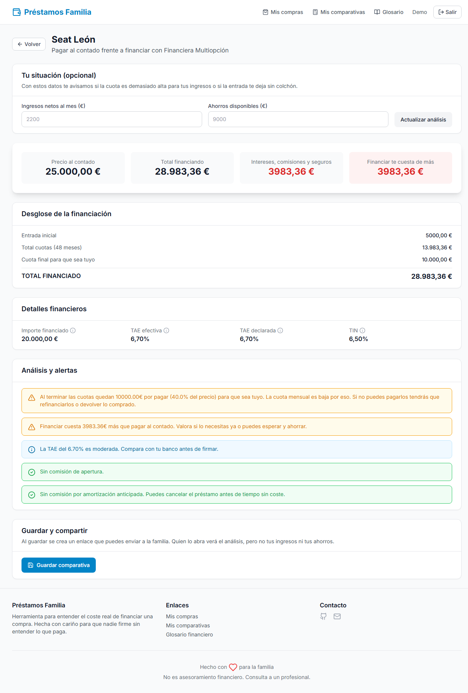

# Préstamos Familia

[](https://github.com/att-22/prestamos-familia/actions/workflows/backend-ci.yml)
[](https://github.com/att-22/prestamos-familia/actions/workflows/frontend-ci.yml)

A web app that shows what financing a purchase really costs compared with paying cash.

Retailers and lenders sell a monthly payment. Whether it is a car, an appliance
or a renovation, this app turns a financing offer into the numbers
that matter — total paid, real APR, and how much more it costs than cash — and
explains them in plain language for people with no financial background. The UI
is in Spanish because that is who it was built for.



## What it does

- **Track purchases and offers.** Save what you are thinking of buying — a
  vehicle, something for the home, a renovation, electronics — and every
  financing offer you get for it.
- **Cash vs. financing.** Total cost of the offer (down payment, instalments,
  balloon payment, mandatory insurance and fees) against the cash price.
- **Effective APR.** Recomputes the APR (TAE) from the actual cash flows, so it
  can be checked against the rate the lender declares.
- **Plain-language alerts.** Around twenty rules flag things worth questioning
  before signing: a high APR, a gap between nominal rate and APR, opening or
  early-repayment fees, tied insurance, long terms, and a large final payment.
- **Personal affordability.** Optionally enter monthly income and savings to see
  the debt-to-income ratio and what is left after the down payment.
- **Shareable results.** Saved comparisons get a public link that shows the
  analysis without the income and savings figures.
- **Glossary.** Searchable definitions of the terms a lender will use.

## How the numbers work

| Figure | Formula |
|--------|---------|
| Financed amount | `cash price − down payment` |
| Fees | `opening fee + financed amount × opening fee %` |
| Insurance | `yearly insurance × months / 12` |
| Total financing cost | `down payment + instalments + balloon payment + insurance + fees` |
| Extra cost vs. cash | `total financing cost − cash price` |
| Effective APR | Monthly rate `r` that solves `financed − fees = Σ instalment/(1+r)ⁿ + balloon/(1+r)ᴺ`, annualised as `(1+r)¹² − 1` |

The balloon payment (residual value) is counted as a cost because the comparison
is about *owning* what you bought: it is what must be paid at the end to keep it. All
money is handled as `Decimal` end to end, never as floats.

The logic lives in [`backend/app/services`](backend/app/services) and is covered
by unit tests.

## Tech stack

| Layer | Tools |
|-------|-------|
| Backend | FastAPI, SQLModel, PostgreSQL 16, Alembic, JWT auth with bcrypt passwords |
| Frontend | React 18, TypeScript, Vite, Tailwind CSS, TanStack Query, React Hook Form + Zod |
| Quality | pytest, ruff, mypy · Vitest, Playwright, ESLint, `tsc` |
| Tooling | Docker Compose, GitHub Actions |

## Project structure

```
backend/
  app/
    api/routes/     HTTP endpoints (auth, purchases, financing offers, comparisons)
    core/           settings, database session, JWT helpers
    models/         SQLModel tables
    schemas/        request/response models
    services/       cost calculation and alert rules (pure functions)
  alembic/          database migrations
  tests/            unit tests for the services, API tests against PostgreSQL
frontend/
  e2e/              Playwright end-to-end tests
  src/
    components/     UI primitives, forms, comparison views, layout
    hooks/          auth context and TanStack Query hooks
    pages/          one component per route
    services/       typed API client
.github/workflows/  CI pipelines
docker-compose.yml  local development stack
```

## Running locally

Requires Docker.

```bash
docker compose up -d --build
```

| Service | URL |
|---------|-----|
| App | http://localhost:5173 |
| API | http://localhost:8000 |
| API docs (Swagger) | http://localhost:8000/docs |

Migrations run automatically when the backend container starts.

To get in, either use the demo buttons on the login screen (development only),
or create an account: by default any `@familia.com` address can register and no
registration code is needed. To use real addresses, put them in a `.env` file
next to `docker-compose.yml`:

```env
ALLOWED_EMAILS=mum@example.com,dad@example.com
REGISTRATION_CODE=something-only-the-family-knows
```

## Tests and checks

```bash
# Backend
docker compose exec backend pytest
docker compose exec backend ruff check app/ tests/
docker compose exec backend mypy app/

# Frontend
cd frontend
npm ci
npm run lint && npx tsc --noEmit && npm run test -- --run && npm run build
```

The API tests run against a real PostgreSQL database inside a transaction that
is rolled back after each test, so they leave no data behind.

### End-to-end tests

A Playwright suite in [`frontend/e2e`](frontend/e2e) drives the app in a real
browser: signing in, creating purchases and offers, checking the calculated
figures, saving a comparison and opening its public link as an anonymous visitor.
Each test signs in as a fresh user, so tests do not share data.

```bash
docker compose up -d                # the tests need the app running
cd frontend
npx playwright install chromium     # first time only
npm run test:e2e
```

After changing a model, generate a migration and review it before committing:

```bash
docker compose exec backend alembic revision --autogenerate -m "describe the change"
docker compose exec backend alembic upgrade head
```

## CI/CD

Each half of the monorepo has its own GitHub Actions workflow, and a third one
runs the end-to-end tests. All of them run on every pull request; on pushes to
`main` the backend and frontend workflows only run when their directory changed.

| Workflow | Job | What it does |
|----------|-----|--------------|
| `backend-ci.yml` | `test` | Starts PostgreSQL as a service container, then runs ruff, mypy, the migrations and pytest with coverage |
| `backend-ci.yml` | `docker` | Builds the production image to make sure it still builds |
| `frontend-ci.yml` | `test` | ESLint, type check, Vitest and a production build |
| `frontend-ci.yml` | `deploy` | Deploys to Vercel — a preview for pull requests, production on `main` |
| `e2e.yml` | `e2e` | Starts PostgreSQL, the API and the production build of the frontend, then runs the Playwright suite against them. The report and traces are uploaded when a test fails |

The deploy job is skipped until the `VERCEL_TOKEN`, `VERCEL_ORG_ID` and
`VERCEL_PROJECT_ID` repository secrets are set.

## Configuration

Docker Compose provides working defaults for local development. For other
environments:

**Backend**

| Variable | Description |
|----------|-------------|
| `DATABASE_URL` | PostgreSQL connection string |
| `JWT_SECRET` | Secret used to sign and verify JWTs. At least 32 characters in production |
| `ALLOWED_EMAILS` | Comma-separated addresses or domains (`@example.org`) allowed to register |
| `REGISTRATION_CODE` | Shared secret required to register. Mandatory in production |
| `ENVIRONMENT` | `development`, `test` or `production` |
| `CORS_ORIGINS` | Comma-separated list of allowed origins |

**Frontend**

| Variable | Description |
|----------|-------------|
| `VITE_API_URL` | Base URL of the backend API |

## Accounts and access

The app is meant for a closed group, so there is no open sign-up:

- **Allow-list.** Only addresses listed in `ALLOWED_EMAILS` can create an
  account. An entry is either an exact address or a whole domain (`@example.org`).
- **Registration code.** Registering also requires `REGISTRATION_CODE`, a shared
  secret handed out by whoever runs the app. Emails are not verified, so this is
  what stops a stranger from claiming an allowed address first. It is mandatory
  in production.
- **Passwords** are at least 10 characters and stored as bcrypt hashes.
- **Brute force.** Five failed attempts for an address from the same IP block
  further attempts for 15 minutes. The counter is kept in memory, which is
  enough for a single backend instance.
- **Forgotten passwords** are reset by the administrator, as there is no email
  service:

  ```bash
  docker compose exec backend python -m app.cli reset-password someone@example.com
  ```

`POST /auth/dev-token`, used by the demo buttons and the tests, signs in as any
address without a password and returns 404 when `ENVIRONMENT=production`.

## Roadmap

- Deploy: the pipeline is ready, pending hosting for the API and its database
- Side-by-side comparison of several offers for the same purchase
- "What if" sliders to explore a larger down payment or a shorter term
- Including mandatory insurance in the effective APR

---

This tool is not financial advice.
